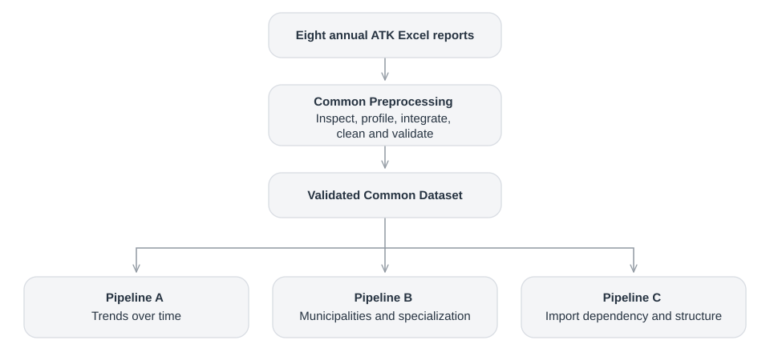
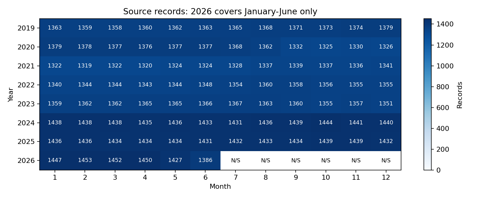
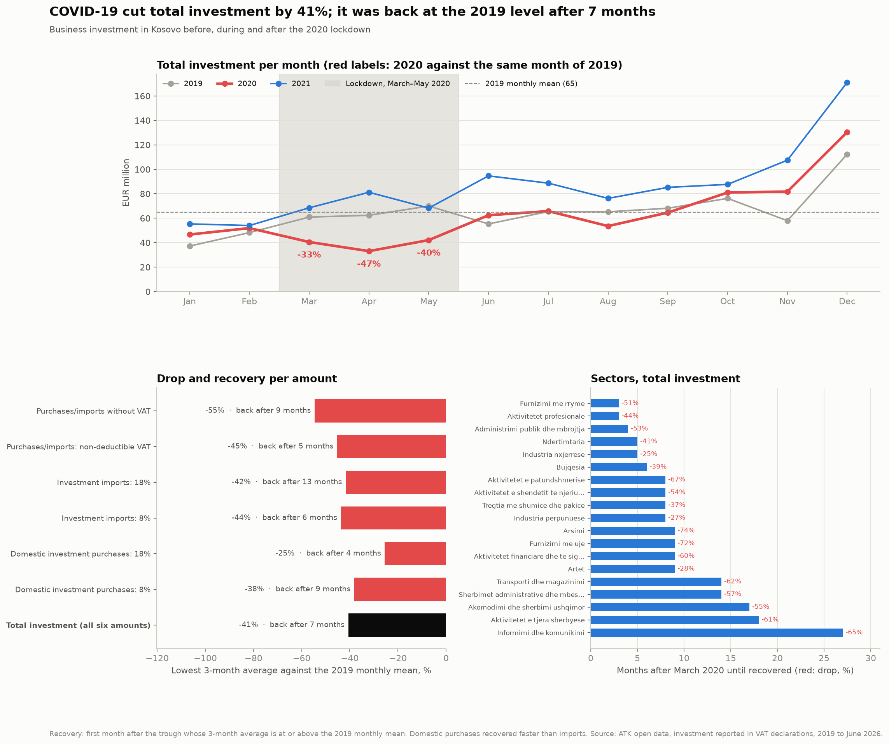
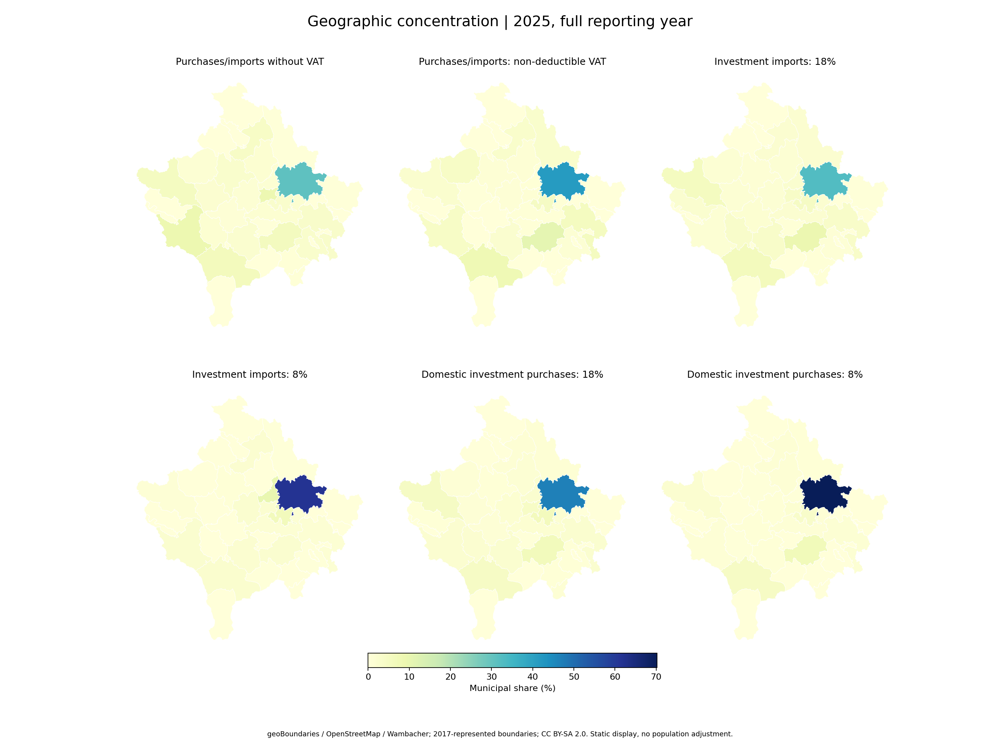
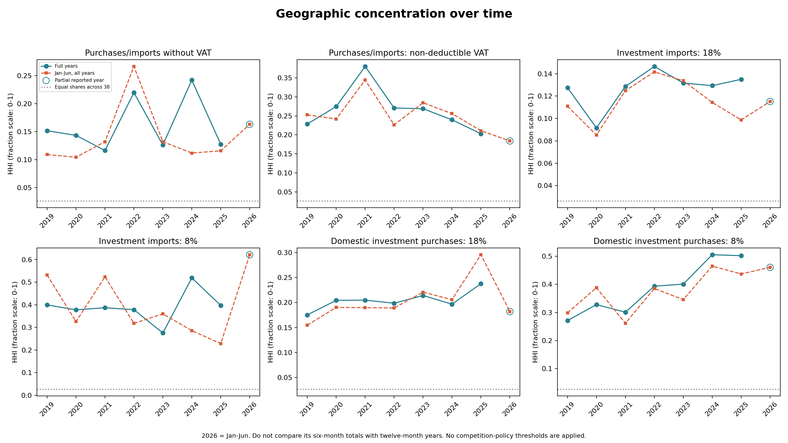

<table>
  <tr>
    <td width="160" align="center">
      <a href="https://uni-pr.edu/">
        
      </a>
    </td>
    <td>
      <strong>University of Prishtina</strong><br>
      <a href="https://fiek.uni-pr.edu/">Faculty of Electrical and Computer Engineering</a><br>
      Computer and Software Engineering — Master's programme<br>
      <strong>Course:</strong> Data Preparation and Visualization
    </td>
  </tr>
</table>

# Kosovo Investment Analysis 2019–2026

**Phase 1: Data Preprocessing**

## Overview

This repository contains the coursework for **Data Preparation and Visualization**. It works with the **Tax Administration of Kosovo (ATK)** open data on investment reported in VAT declarations, eight annual Excel reports from 2019 to June 2026.

One shared preprocessing workflow turns the eight reports into a validated **Common Dataset**. Phase 1 then builds three analytical pipelines on it:

- **Pipeline A — Investment Trends and Evolution**
    - **Main question:** How have reported values evolved during 2019–2026, how did the COVID-19 period affect them, and is there a regular pattern within the year?
    - **Main techniques:** Time aggregation, total investment, growth and trend features, COVID-19 drop and recovery, seasonal decomposition, discretization and bootstrap sampling
    - **What it does:** aggregates investment by month, quarter and year with `total_investment`, measures growth, the trend, the **COVID-19 drop and recovery** and the **seasonal pattern**, and compares 2026 through a January–June window.

- **Pipeline B — Municipal Concentration and Sector Specialization**
    - **Main question:** How unevenly are values distributed across municipalities, which municipalities dominate, and where does each municipality specialize?
    - **Main techniques:** Municipal shares, Pareto analysis, HHI, LQ, discretization and stratified sampling
    - **What it does:** measures each municipality's share and the geographic concentration (**HHI**, Pareto), and in which sectors each municipality specializes (**Location Quotient**).

- **Pipeline C — Import Dependency and Investment Structure**
    - **Main question:** How much of the identified-origin amount comes from imports, and which sectors are more domestically oriented?
    - **Main techniques:** Origin-group features, feature selection, log transformation, standardization, PCA and bootstrap
    - **What it does:** splits investment into **imports, domestic purchases and mixed** amounts, computes the import share with its bounds for sectors and municipalities, and reduces the sector-year structure with **PCA**.

The project explicitly exercises the Phase 1 topics of the course:

- data collection, **type definition** and **data quality**;
- **integration**, aggregation, sampling, cleaning and **missing-value** identification and treatment;
- **dimensionality reduction**, feature subset selection, **feature creation**, discretization and binarization, transformation.

<p align="center">
  
</p>

---

## Project topology

The repository is organised as **one shared preprocessing stage and three pipelines**. Every stage is a numbered script; the number gives the order in which it runs.

```text
Kosovo-Investment-Analysis-PVDH_2026_27/
│
├── data/
│   ├── raw/                        8 original ATK Excel files (never modified)
│   ├── intermediate/               checkpoints written by the stages
│   ├── processed/                  common_dataset.csv + common_validation.json
│   └── reference/                  municipality boundaries and name crosswalk (maps)
│
├── src/                            shared schema, Excel reader, I/O and validation helpers
│
├── phase_1/
│   ├── 01_data_inspection.py       ┐
│   ├── 02_data_quality.py          │
│   ├── 03_data_integration.py      │  Common preprocessing
│   ├── 04_data_cleaning.py         │  → data/processed/common_dataset.csv
│   ├── 05_missing_values.py        │
│   ├── 06_common_validation.py     ┘
│   ├── run_common_preprocessing.py
│   │
│   ├── pipeline_a/                 Investment trends and evolution
│   │   ├── 01_aggregation.py
│   │   ├── 02_feature_creation.py
│   │   ├── 03_transformation.py
│   │   ├── 04_discretization_binarization.py
│   │   ├── 05_sampling_sensitivity.py
│   │   ├── 06_visualization.py
│   │   └── run_pipeline_a.py
│   │
│   ├── pipeline_b/                 Municipal concentration and sector specialization
│   │   ├── 01_feature_selection_aggregation.py
│   │   ├── 02_geographic_share_hhi.py
│   │   ├── 03_sector_specialization_lq.py
│   │   ├── 04_discretization_binarization.py
│   │   ├── 05_sampling_sensitivity.py
│   │   ├── 06_visualization.py
│   │   └── run_pipeline_b.py
│   │
│   └── pipeline_c/                 Import dependency and investment structure
│       ├── 01_feature_creation_aggregation.py
│       ├── 02_feature_selection.py
│       ├── 03_transformation_pca.py
│       ├── 04_discretization_binarization.py
│       ├── 05_sampling_bootstrap.py
│       ├── 05b_sample_sensitivity.py
│       ├── 06_visualization.py
│       └── run_pipeline_c.py
│
├── notebooks/                      01 common · 02 Pipeline B · 03 Pipeline A · 04 Pipeline C
├── outputs/
│   ├── tables/                     result tables of every stage (CSV)
│   └── figures/                    figures of every stage (PNG)
├── tests/                          automated tests for the common stages and each pipeline
└── docs/                           images and supporting documentation
```

**Conventions**

- **Modular:** every stage reads the output of the previous stage and writes its own, so any stage can be rerun alone.
- **Traceable:** every record keeps its source file, sheet and Excel row; original labels are kept next to cleaned ones.
- **Validated:** each part ends with checks that stop the run on any unexplained change; the pipelines only start from a Common Dataset whose validation status is `PASS`.

---

## Dataset

- **Source:** [ATK Open Data — investment according to VAT declarations](https://www.atk-ks.org/open-data/), files `data/raw/Investimet-2019.xlsx` … `Investimet-2026.xlsx`.
- **One record** is a monthly group of businesses with the same **sector, registration status and municipality**, with a taxpayer count and six investment amounts. It is not a single business or transaction.
- **Coverage:** 38 municipalities, 23 sector labels, 26 registration-status labels; 2026 contains January–June only.

| Year | Records | Months |
|---|---:|---|
| 2019 | 16,395 | Jan–Dec |
| 2020 | 16,307 | Jan–Dec |
| 2021 | 15,949 | Jan–Dec |
| 2022 | 16,201 | Jan–Dec |
| 2023 | 16,332 | Jan–Dec |
| 2024 | 17,249 | Jan–Dec |
| 2025 | 17,214 | Jan–Dec |
| 2026 | 8,615 | **Jan–Jun only** |
| **Total** | **124,262** | 90 year–months |

### Attributes and types

| Attribute | Type | Scale | Meaning |
|---|:---:|:---:|---|
| `year` | `Int16` | interval | Reporting year |
| `month` | `Int8` | ordinal / cyclic | Reporting month |
| `primary_sector`<br>`registration_status`<br>`municipality` | `string` | nominal | Group categories |
| `taxpayer_count` | `Int64` | ratio | Businesses in the group |
| `investment_purchases_imports_without_vat` | `float64` | ratio | Purchases **and** imports without VAT (origin mixed) |
| `investment_purchases_imports_nondeductible_vat` | `float64` | ratio | Purchases **and** imports with non-deductible VAT (origin mixed) |
| `investment_imports_18pct`<br>`investment_imports_8pct` | `float64` | ratio | Investment imports at 18% / 8% |
| `domestic_investment_purchases_18pct`<br>`domestic_investment_purchases_8pct` | `float64` | ratio | Domestic investment purchases at 18% / 8% |

---

## Common preprocessing

The eight ATK files are reports made for reading, not tables made for analysis: each has a title, empty separator columns and a total row, and the eight years are separate files. Six stages turn them into one clean, validated dataset that all three pipelines share. Only stages 03 and 04 change the data; the others inspect, report or check.

```text
8 Excel reports   titles, report totals, 16-column layout
  │
  ├─ 01 inspect     rows classified, 12 attributes typed
  ├─ 02 profile     quality report
  ├─ 03 integrate   one schema with provenance
  ├─ 04 clean       labels trimmed, 6 review flags
  ├─ 05 missing     missing-value strategy
  └─ 06 validate    independent re-check of every value
  ▼
data/processed/common_dataset.csv
```

### 01 · Inspection and type definition

`01_data_inspection.py` · *Requirement: data collection, type definition*

**Why:** before the data can be read correctly, we need to know where the real records are and what each column means.

- Each workbook is read separately: the header is on Excel row 6, with 12 meaningful columns in a 16-column layout.
- Every row is classified as title, header, record, report total or blank. The total row is recognised by proving that its numbers are the sums of the records above it, so it can never enter the data.
- Every attribute gets its type and scale of measurement (nominal, ordinal, interval, ratio).

### 02 · Data quality

`02_data_quality.py` · *Requirement: data quality*

**Why:** to know what is wrong with the data before changing anything. This stage only reports.

| Check | Finding |
|---|---:|
| Empty cells and missing markers | **0** |
| Duplicate records | **0** |
| Sector `Mungon aktiviteti` (activity unavailable) | **4,484 records (3.61%)** |
| Extra spaces in category labels | **1,414 cells** |
| Negative amounts | **82 cells in 79 records** |
| Records with zero in all six amounts | **77,955 (63%)** |

`Person Fizik` appears as a sector label in **2,734 records**. It is treated as ambiguous: not missing, and not assigned to an economic sector.

### 03 · Integration

`03_data_integration.py` · *Requirement: integration*

**Why:** the eight years arrive as eight separate files with trilingual headers; the analysis needs one table.

- The headers are mapped to 12 standard names, and every year is checked to have the same columns and types.
- The eight sources are joined into one table.
- Every record keeps its source file, sheet and Excel row, and the original category labels are kept in `_raw` columns, so any value can be traced back to the original Excel cell.

### 04 · Cleaning

`04_data_cleaning.py` · *Requirement: cleaning*

**Why:** to fix what is certainly an error, and to mark, not delete, what only looks unusual.

| Finding | Decision | Reason |
|---|---|---|
| Extra spaces in labels | Trimmed (1,414 cells) | Formatting error; original labels kept |
| `Mungon aktiviteti` | Kept and flagged | No correct sector is known |
| Zeros | Kept | Zero is a real value, not a missing one |
| Negative amounts | Kept and flagged | Likely corrections of earlier declarations ([ATK legislation, p. 419](https://www.atk-ks.org/wp-content/uploads/2017/12/Legjislacioni-Tatimor-i-Kosov%C3%ABs-Botimi-III.pdf)) |
| Very large amounts | Flagged, not removed | Can be real large investments; checked in Phase II |

Every change is written to `04_cleaning_audit.csv` with its old and new value.

### 05 · Missing values

`05_missing_values.py` · *Requirement: identification and treatment of missing values*

**Why:** to decide what to do with information that is missing, instead of silently filling or dropping it.

- The only missing information is the sector `Mungon aktiviteti`.
- **Strategy:** the 4,484 records keep their amounts and are flagged (`sector_unclassified`). They count in time and municipal totals; sector analyses leave them out. No sector is guessed.
- July–December 2026 has not been published yet, so no rows or zeros are created for those months.

### 06 · Validation and output

`06_common_validation.py` · *Requirement: data quality*

**Why:** to prove that preprocessing lost or changed nothing it should not have.

- The Excel cells are read a second time, independently, and compared with the final data: number of records, every value, every year × amount total, and the raw-file fingerprints.
- The result is `data/processed/common_dataset.csv` (12 attributes, 4 provenance fields, 3 original labels, 6 flags), with its validation status in `common_validation.json`.

> **What changed in the data:** 0 rows removed · 0 numbers changed · 1,414 labels trimmed · 48 / 48 year × amount totals identical before and after.



*Reporting coverage: 2026 contains January–June only. N/S marks months outside the supplied coverage.*

---

## Pipeline A — Investment Trends and Evolution

> **Key question:** How have reported values evolved during 2019–2026, how did the COVID-19 period affect them, and is there a regular pattern within the year?

The six stages implement feature selection/aggregation, temporal feature creation, transformation, discretization/binarization, sampling sensitivity and visualization. Besides the six monetary categories, A follows `total_investment`, their sum. Every result is produced for two windows: all **reported** months, and **January–June** of every year, so the partial year 2026 is compared with the same months of earlier years.

### Stages

1. **`01_aggregation.py`** — selects the 9 attributes a time question needs, adds `total_investment` and sums the records by month, quarter, year and month × sector.
2. **`02_feature_creation.py`** — growth against the previous year and month, rolling means, the trend, the seasonality index, COVID-19 and lockdown flags, and the drop and recovery of every sector.
3. **`03_transformation.py`** — index 2019 = 100, additive seasonal decomposition, `log1p` and z-scores.
4. **`04_discretization_binarization.py`** — growth classes with fixed thresholds, compared with equal-width and equal-frequency binning, and 0/1 flags.
5. **`05_sampling_sensitivity.py`** — bootstrap intervals for totals and growth, and 10% samples compared with the full data.
6. **`06_visualization.py`** — nine figures (`a01`–`a09`); `run_pipeline_a.py` runs all stages and validates the outputs.

### Main indicators

For one monetary category and period, year-over-year growth and the 2019-based index are:

$$
g_t=\frac{V_t-V_{t-1}}{V_{t-1}}\times 100, \qquad I_t=\frac{V_t}{V_{2019}}\times 100
$$

Growth is computed only between periods with the same number of months, so 2026 is compared only in the January–June window. A straight-line trend through the complete years 2019–2025 gives the average yearly change.

Seasonality is measured with a monthly index:

$$
S_m=\mathrm{mean}_{y}\frac{V_{y,m}}{\bar V_y}
$$

Here $\bar V_y$ is the monthly mean of year y. $S_m = 1$ is an average month; values above 1 mark systematically strong months. An additive decomposition separates the monthly series into trend, seasonal effect and residual, so growth is not confused with a strong December.

The COVID-19 drop is the lowest 3-month average in the first pandemic year against the 2019 monthly mean. Recovery is the first month after that low point whose 3-month average is back at the 2019 level, counted from March 2020. A month without records for a sector counts as zero. `Mungon aktiviteti` and `Person Fizik` remain in the national series but are excluded from the sector comparison.

### Additional preprocessing techniques

- **Feature selection/aggregation:** 9 of the 25 Common Dataset attributes, summed by month, quarter, year and month × sector. The coefficient of variation of total investment falls from 0.45 (months) to 0.33 (years).
- **Transformation:** the 2019 = 100 index, seasonal decomposition, `log1p` and z-scores. `log1p` lowers the skewness of monthly totals from 0.95 to −0.10.
- **Discretization/binarization:** growth classes at −20%, −5%, +5% and +20%, compared with equal-width and equal-frequency binning; flags `growth_positive`, `mom_positive`, `above_trend`, `is_covid` and `is_lockdown`. Fixed thresholds are kept because equal width puts 68% of the months in one class.
- **Sampling:** 200 bootstrap resamples per year (seed 42) for 95% intervals, and 10% simple and month-stratified samples over 20 draws. It is a sensitivity check; main findings use all records.

### Selected findings

Total investment rose from **EUR 780 million in 2019 to EUR 1,835 million in 2025**, index **235**, about **15% a year** on an almost straight trend (R² **0.97**). It grew every year except 2020; January–June 2026 is **+3%** against January–June 2025.

COVID-19 was a deep but short shock. In March, April and May 2020 total investment was **−33%, −47% and −40%** below the same months of 2019, and it was back at the 2019 level after **7 months**. Domestic purchases at 18% recovered in 4 months, imports at 18% in 13; accommodation, transport and information and communication took longest. Over the full year 2020 the total fell only **−3%**, a change the bootstrap interval cannot separate from zero, while the January–June decline (**−17%**) is clear.

December is **1.80×** an average month; January and February are the weakest. The largest residual, September 2024, is linked to a single EUR 97.5 million record and is the first outlier candidate for Phase II. A 10% sample misses annual totals by about 13%, so it is not used to replace full-data estimates.



*Total investment per month in 2019–2021 with the lockdown months labelled, the drop and recovery of every monetary category, and the recovery time of every sector. Recovery is measured against the 2019 monthly mean, not against the pre-pandemic trend.*

**Notebook:** [Investment trends and evolution](notebooks/03_pipeline_a_investment_trends.ipynb).

---

## Pipeline B — Municipal Concentration and Sector Specialization

**Question:** How unevenly are reported values distributed across municipalities, which municipalities dominate, and in which sectors does each municipality specialize?

The six stages implement feature selection/aggregation, geographic concentration, LQ, descriptive features, sampling sensitivity and visualization.

### Main indicators

For one monetary category and period, municipal share and geographic HHI are:

$$
s_m=\frac{V_m}{\sum_j V_j}, \qquad HHI=\sum_m s_m^2
$$

Shares identify each municipality's contribution. Pareto ranking shows how many municipalities reach 80% of the value. Higher HHI means greater concentration; equal shares across 38 municipalities give HHI = 1/38.

Sector specialization is measured with Location Quotient:

$$
LQ_{m,s}=\frac{V_{m,s}/V_{m,E}}{V_s/V_{K,E}}
$$

Here E is the eligible-sector subset and K is Kosovo. `Mungon aktiviteti` and the ambiguous `Person Fizik` label remain in geographic totals but are excluded from **both** LQ denominators. Coverage is reported separately. LQ > 1 indicates above-national relative sector weight, not necessarily a large absolute amount.

Geographic shares require nonnegative municipal net totals and a positive national total. Under B's conservative rule, any negative eligible municipality–sector net cell withholds LQ for that year/category/window block. Zero denominators also produce NA; a zero numerator with positive denominators gives LQ = 0.

### Additional preprocessing techniques

- **Discretization/binarization:** share bands at 0%, 1% and 5%; `top_contributor` for share ≥5%; LQ bands at 1 and 2; `high_specialization` for LQ >1. Thresholds are descriptive, and undefined flags remain NA.
- **Sampling:** a 20% year × municipality stratified sample, weighted by N/n, with seed 42. It is a sensitivity check; main findings use all records.
- **Visual scaling:** log2 colours for LQ and symlog/log scatter axes improve readability. They do not modify exported indicator values.

### Selected findings

In **2025**, Prishtinë leads all six measures. For domestic investment purchases at 18%, it represents **46.83%** of the reported amount; the top five municipalities account for **68.82%**, with HHI **0.2378**. Nine municipalities reach 80%.

Relative specialization tells a different story: Zubin Potok has transport/storage LQ **43.35**, based on a cell amount of **41,101.69** in source monetary units. Always read LQ alongside amounts and denominators. The 20% sample changed HHI by up to **0.5562**, so it is not used to replace full-data concentration estimates.



*Municipal shares in the latest complete year, 2025. One colour scale supports comparison across categories. Boundaries are a static 2017 reference, not historical boundary harmonization or a population adjustment.*



*HHI tracks municipal concentration separately for each monetary category: higher values mean greater concentration. Full-year results cover 2019–2025; the January–June series provides a comparable window for all years, including partial 2026. The dotted line represents equal shares across 38 municipalities.*

**Notebook:** [Municipal concentration and sector specialization](notebooks/02_pipeline_b_geography_specialization.ipynb).

---
